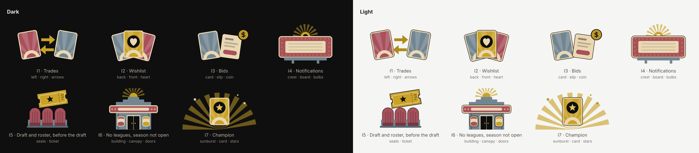

# Marquee illustrations

The iOS app's illustration style (docs/IOS-DELIGHT-PLAN.md section 5.2): bold flat
shapes, art-deco sunbursts, poster cards with an ivory border. Seven pieces for the
first release, each made of two or three layers so the parts can slide into place.



| Piece | Where | Layers (back to front) |
| --- | --- | --- |
| I1 `trades` | Trades, empty | left, right, arrows |
| I2 `wishlist` | Wishlist, empty (mine and league-mates) | back, front, heart |
| I3 `bids` | Bids, empty; bid history, empty | card, slip, coin |
| I4 `notifications` | Notifications, empty | crest, board, bulbs |
| I5 `draft` | Draft before it starts; roster before the draft | seats, ticket |
| I6 `entrance` | No leagues yet; season not open | building, canopy, doors |
| I7 `champion` | Season complete, behind the champion card | sunburst, card, stars |

In SwiftUI: `MarqueeArt(.trades)` draws a piece at its fixed size (216 pt, champion
200 pt) with VoiceOver hidden. `MarqueeIllustration.layers` names the layers for
anything that animates them one by one.

## Changing the art

The SVGs in `FantasyReel/Resources/Assets.xcassets/Marquee/` are generated. Edit
`generate.mjs`, then run, from the repository root:

```sh
node apps/ios/docs/marquee/generate.mjs   # rewrites the asset catalog
node apps/ios/docs/marquee/preview.mjs    # redraws preview.png (needs Playwright)
```

- Every layer is a full 240 × 132 canvas, so layers stack with no offsets.
- Only what Xcode's asset catalog draws: paths, rects, circles, solid fills and
  strokes, transforms, fill-opacity. No clip paths, masks, gradients, filters or
  text. Shapes that need clipping are clipped in the geometry.
- Colors are the brand palette: gold `#c9a227`, light gold `#e3c35a`, burgundy
  `#a8505c`, blue-gray `#718691`, ivory `#ead8b3`, ink `#0f0f0f`. Flat fills only.
- Light theme: the same colors, plus an ink keyline where an ivory edge would
  disappear into the light page, and a deeper gold for shapes that sit straight on
  the page (arrows, stars).
- The `marqueeEmpty` and `marqueeMoments` screenshot scenes show every piece as the
  simulator draws it, in both themes.
