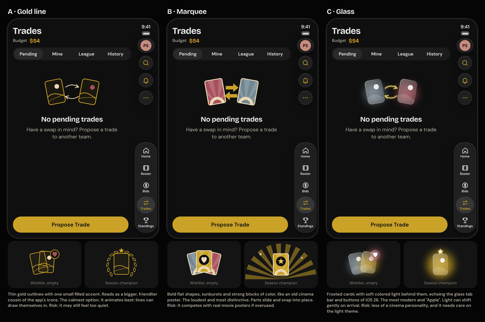
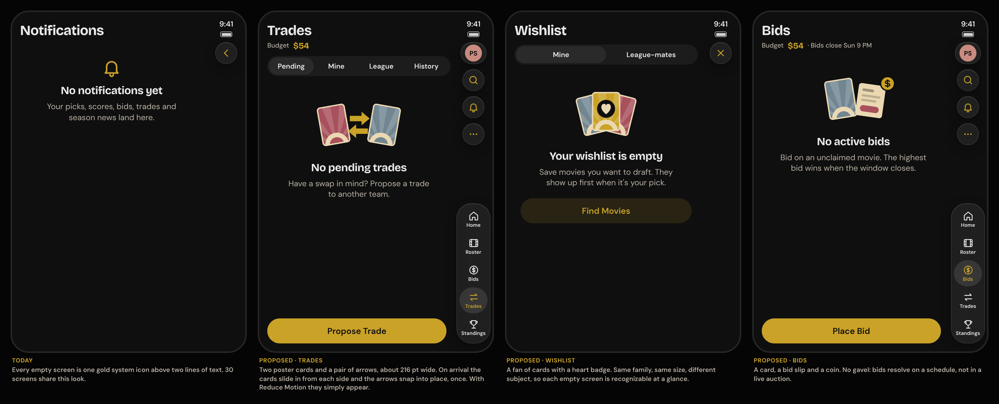
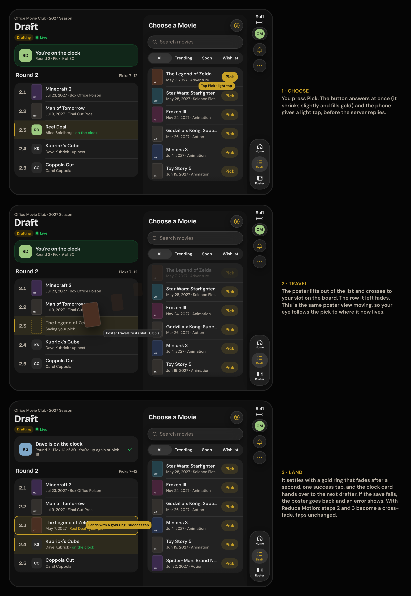
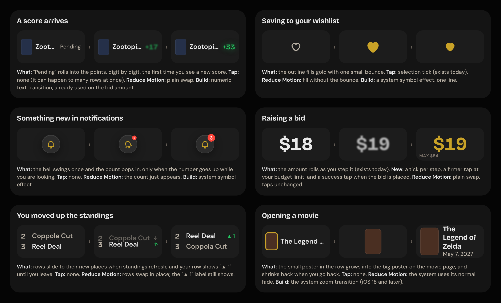
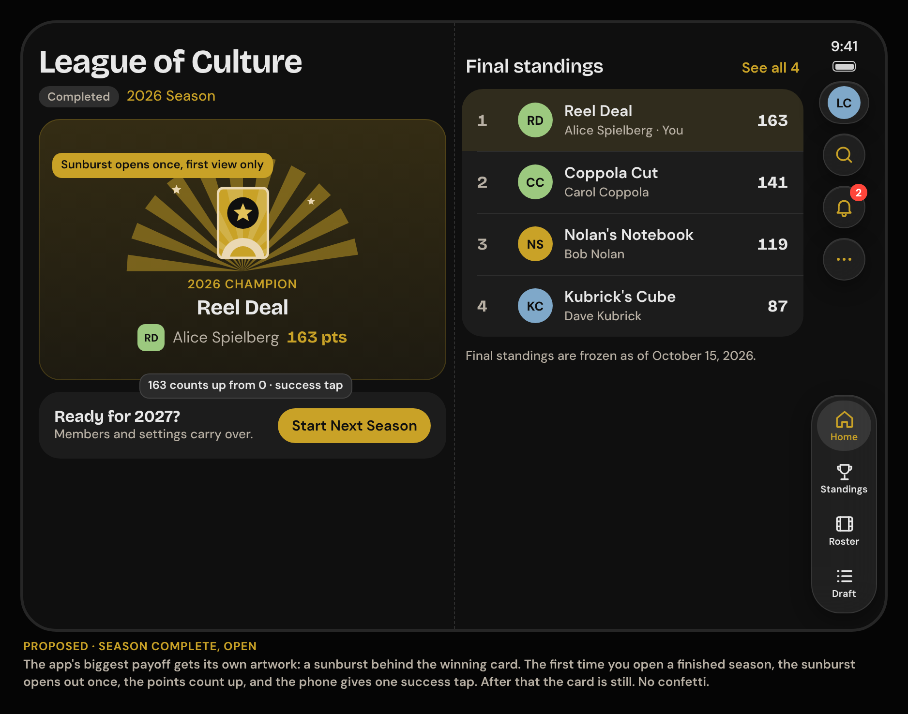
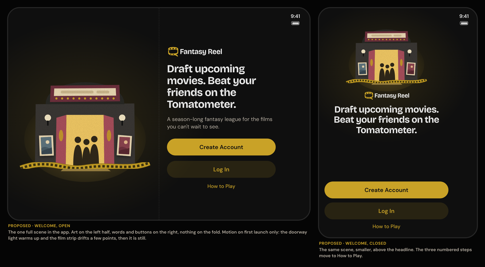

# iOS delight plan: illustration, motion and haptics

Status: proposal, 2026-11-11. Nothing here is built. Open questions for Arik are in
section 10. This plan sits beside the [iPhone Duo plan](IOS-DUO-PLAN.md) and is
written so it never blocks it (section 9).

The complaint this answers: the iOS app (`apps/ios/`) works, but it feels boring. There
are no illustrations and almost nothing moves.

Claims about Apple's guidance are quoted from the Human Interface Guidelines pages
listed in section 11 and marked **[Apple]**. Everything else is our proposal.

## 1. The short version

- The app is correct and consistent, but flat. All 30 empty screens are one gold system
  icon over two lines of text. Nothing animates except button presses, images fading in
  and one segmented control. Only three places give a haptic tap.
- Apple's advice is not "animate more". It is "add motion when it means something, keep
  it short, never make people wait for it, and make it optional" **[Apple]**. So the
  plan is **quiet most of the time, with a few moments that land**.
- Three layers, cheapest first:
  1. **Feedback** on things you do (taps, small icon animations, numbers that roll).
     Dozens of places, each a line or two of code.
  2. **Illustrations** on empty and welcome screens, in a new style made for the iOS
     app, called Marquee (Arik's decisions; section 5.2). About eight pieces of art.
  3. **Moments**: two or three places where the app celebrates. Making a draft pick,
     a score arriving, winning the season.
- It fits the Duo work without blocking it: one small foundations thread adds the
  shared pieces as new files, the four Duo Phase 1 threads apply a short checklist to
  screens they are already editing, and the draft-pick moment rides with the Duo draft
  room thread (2A).
- Everything honors Reduce Motion, and no information is ever carried by motion or a
  tap alone.

## 2. Words used in this doc

| Term | Plain meaning |
| --- | --- |
| Micro-animation | A small, short movement that answers something you did: a heart filling in, a number rolling to its new value. Usually under half a second. |
| Haptic | A short tap you feel from the phone's vibration motor. iOS has a small fixed set: success, warning, error, light/medium/heavy impact, and a selection tick. |
| SF Symbols | Apple's icon set, which the app already uses for every icon. Symbols come with built-in animations (bounce, wiggle, pulse, replace, draw on). |
| Symbol effect | One of those built-in icon animations. One line of SwiftUI (`.symbolEffect`). |
| Transition | How one screen or state turns into the next (slide, fade, zoom). |
| Spring | An animation that eases into place like a physical object, instead of moving at a constant speed. The iOS default feel. |
| Reduce Motion | An iOS accessibility setting for people who get dizzy or distracted by movement. Apps must replace movement with fades or nothing. |
| Liquid Glass | iOS 26's translucent material for bars and floating controls. The app already uses it for the tab bar, top-bar buttons and the league pill. |
| Empty state | What a screen shows when it has no content yet ("No pending trades"). |
| Skeleton | Gray placeholder shapes shown while content loads, in place of a spinner. |
| Storybook | The illustration style chosen for the Fantasy Reel website: cut-paper shapes, light grain, gold, burgundy, ivory and blue-gray. Not used for iOS (Q1). |

## 3. What Apple says

Apple does publish design documentation on all of this. The relevant pages and what
they ask for:

**Motion.** "Don't add motion for the sake of adding motion." "In apps, generally avoid
adding motion to UI interactions that occur frequently." "Aim for brevity and precision
in feedback animations." "Make motion optional." "Let people cancel motion": never make
someone wait for an animation to finish before they can act **[Apple]**.

**Reduce Motion.** When it is on, an app should be "reducing automatic and repetitive
animations". Apple's list: tighten springs to reduce bounce, replace slides and zooms
with fades, avoid animating depth, avoid animating into and out of blurs. "Be cautious
with fast-moving and blinking animations" **[Apple]**.

**Haptics.** Each pattern has a meaning and should be used only for it **[Apple]**:

| Pattern | Apple's meaning |
| --- | --- |
| Success | "a task or action has completed" |
| Warning | "a task or action has produced a warning of some kind" |
| Error | "an error has occurred" |
| Impact, light to heavy | a collision between small, medium or large interface objects |
| Selection | "a UI element's values are changing" |

"Avoid overusing haptics": a tap that feels right occasionally becomes "tiresome when it
plays frequently." "Make haptics optional." Use patterns "according to their documented
meanings" **[Apple]**.

**Icon animations (SF Symbols).** Built-in effects, each with a purpose **[Apple]**:
Bounce ("communicate that an action occurred or needs to take place"), Wiggle
("highlight a change or a call to action that a person might overlook"), Pulse and
Breathe (ongoing activity or status), Variable color (progress, "connecting"), Replace
(one icon turning into another, "communicating a change in state"), Draw On (new in
iOS 26, reinforces meaning or shows progress). "Apply symbol animations judiciously...
too many animations can overwhelm an interface and distract people."

**Liquid Glass.** It is for "controls and navigation" that float above content. "Don't
use Liquid Glass in the content layer." "Use Liquid Glass effects sparingly" **[Apple]**.
So glass is not where more personality should come from. Our cards and rows stay solid.

**Loading.** "Show something as soon as possible", using placeholders that are replaced
as content arrives **[Apple]**. That argues for skeletons over centered spinners.

**Onboarding and launch.** Onboarding should be "fast, fun, and optional". "Consider
providing a collection of context-specific tips instead of a single onboarding flow."
The launch screen should be "nearly identical to the first screen", with no splash
animation or logo show **[Apple]**. So: no animated splash, and no multi-page intro
carousel.

**Illustration.** Apple gives no style guidance for illustrations. Its only relevant
rule is technical: provide sharp artwork for every screen density **[Apple]**. Style is
ours to choose, and the brand guide has already chosen it.

Nothing new in iOS 27 changes this plan. We checked Apple's WWDC 2026 SwiftUI and iOS
guides: no new symbol effects or haptics. Every API below exists on iOS 26, our minimum.

**General practice** (ours, drawn from well-regarded apps rather than Apple's pages):
animate what the user just touched before anything else; let one thing move at a time;
spend the "wow" budget on the two or three moments people will remember and tell friends
about; and give empty screens a reason to smile, since new users see them first.

## 4. Where the app stands today

Audited at `main` (`30c56e8`), 242 Swift files.

| What | Today | Note |
| --- | --- | --- |
| Illustrations | 0. The asset catalog holds only the logo, wordmark and provider logos. | `EmptyStateView` already accepts an image in place of an icon, but shows it at 55 × 48 pt and nothing uses it. |
| Empty screens | About 30, all the same: a 40 pt gold SF Symbol, a title, a line of text. | See "Today" in the first mockup. |
| Animation | 16 files, almost all one of: button press scale (0.12 s), image fade-in, a screen cross-fade at sign-in. | No shared timing values. Each file picks its own numbers. |
| Icon animations | 0 uses of `symbolEffect`. | The bell, heart, tab icons and status icons never move. |
| Rolling numbers | 1 (the bid amount). | Scores, points, budget and rank all snap. |
| Shared-element transitions | 0. | Tapping a movie row is a plain push. |
| Haptics | 3: pick saved (success), you're on the clock (light impact), wishlist save (selection). | Bids, trades, drops and errors are silent. |
| Reduce Motion | Checked in 2 files. | Fine today because so little moves. It must become automatic before we add more. |
| Loading | Centered spinner with a label, about ten places. | Content pops in all at once. |
| Liquid Glass | Used correctly: tab bar, top-bar buttons, league pill, a few system glass buttons. | No change proposed. |
| Brand illustration style | Storybook, chosen for the web and documented, with three concept images. Not used on any screen yet. | Arik chose a separate style for iOS (Q1). |

What is already good and should not change: the type, color and spacing system; one
filled gold action per card; whole-number points; and the restraint. The app is easy to
read. The goal is to add warmth without making it busier.

## 5. The direction

### 5.1 Principles

1. **Quiet by default.** Screens full of data (roster, standings, bids, trade cards)
   get no decoration. They get feedback when you act and when values change.
2. **Art where there is nothing else to look at.** Empty and welcome screens only. When
   content arrives, the art goes away.
3. **A few moments that land.** Draft pick, a score arriving, the champion. Each plays
   once, takes under a second, and never blocks the next tap.
4. **Motion explains.** Something moves because it went somewhere or changed. A poster
   travels to the slot it now fills. A row slides to its new rank.
5. **You did it, you feel it.** Haptics confirm your own actions. Things other people
   do never buzz your phone, with one existing exception: it becoming your turn in a
   live draft.
6. **Optional and redundant.** Every animation has a Reduce Motion version. Every
   animated or haptic signal is also visible as text or a label.
7. **One family.** One illustration style in the app, one set of timings, one haptic map. A screen
   never invents its own.

### 5.2 Illustrations

**Decisions (2026-11-11): the iOS app gets its own illustration style, not the web's
Storybook family (Q1), and that style is B, Marquee (Q1b).** Marquee is bold flat
shapes, art-deco sunbursts and strong blocks of color, like an old cinema poster. The
three candidates that were compared, each drawing the same three subjects:

| | A. Gold line | B. Marquee | C. Glass |
| --- | --- | --- | --- |
| Look | Thin gold outlines, one small filled accent | Bold flat shapes, art-deco sunbursts, strong color blocks | Frosted cards with soft colored light behind |
| Feel | Calm, close to the app's icons | Loud, most like a cinema poster | Modern, closest to iOS 26's glass |
| Animates by | Lines drawing themselves in | Parts sliding and snapping into place | Light shifting, cards floating in |
| Light theme | Easy (swap line color) | Easy (flat colors) | Needs a separate treatment; glow reads poorly on white |
| How it ships | Vector, tiny files | Vector, tiny files | Layered images (blur is costly to draw live) |
| Risk | May still feel too quiet | Competes with real posters if overused | Least "cinema" personality |

Why Marquee: it answers "boring" most directly, it is plain vector art (so it stays
sharp on both Duo screens, recolors for the light theme, and its parts can move), and
its sunburst becomes the shared shape behind the champion and draft moments.

Marquee rules:

- **Palette:** gold, burgundy, blue-gray and ivory on charcoal, from the brand colors.
  Flat fills only. No gradients, texture or glow.
- **Vocabulary:** poster cards with an ivory border, a half-sun and rays, bold arrows,
  round badges, small stars. Every piece is built from these.
- **Restraint:** it is loud, so it appears only on the screens in the table below. It
  never sits beside real movie posters, which it would compete with.
- Carried over from the brand guide: no confetti, no gavel for bids, original poster
  art only, and art is removed once a screen has content.

The empty-screen and champion mockups in section 7 are drawn in Marquee. The welcome
mockup still shows the earlier Storybook stand-in; it is later scope and will be
redrawn then.

| # | Illustration | Where | Size | Release |
| --- | --- | --- | --- | --- |
| I1 | Two poster cards and a pair of arrows | Trades, empty | about 216 pt wide | First |
| I2 | Fan of cards with a heart badge | Wishlist, empty (mine and league-mates) | 216 pt | First |
| I3 | Card, bid slip and coin | Bids, empty; bid history, empty | 216 pt | First |
| I4 | Quiet cinema marquee | Notifications, empty | 216 pt | First |
| I5 | Seats and a ticket | Draft before it starts; roster before the draft | 216 pt | First |
| I6 | Cinema entrance (smaller cut) | No leagues yet; season not open | 216 pt | First |
| I7 | Sunburst behind a winning card | Season complete, champion card | about 200 pt | First (see Q4) |
| I8 | Cinema entrance, full scene | Welcome (signed out) | 240 pt closed, 380 pt open | Later |

The other twenty-odd empty states (search with no results, "only the commissioner can
change settings", "team not found") stay as an icon and text. They are errors or
dead ends, not places to linger, and a drawing there would be noise.

Rules:

- **Fixed size, not stretched.** An illustration is the same size on a small iPhone and
  on the Duo's open screen. On the open screen it centers in its own column and never
  sits across the fold.
- **Light and dark.** Ivory paper cards vanish on the light theme's background. Every
  piece is checked in both themes and gets a light variant if its outline is lost.
- **Hidden from VoiceOver.** The title and message beside it already say everything.
- **Built in parts.** Each piece is two or three separate vector parts (for example:
  left card, right card, arrows), so the parts can slide and snap into place on
  arrival. No animation library is added (the app has one third-party dependency and
  should keep it that way).
- **Small files.** Target under 100 KB per illustration across all its layers, checked
  in the PR.

The vector drawings in the mockups are close to shippable and would be refined, not
redone (Q3).

### 5.3 Motion

Three tiers, so every animation has an obvious budget:

| Tier | For | Length | Examples |
| --- | --- | --- | --- |
| Feedback | Answering a tap | 0.1 to 0.25 s | Button press, heart fill, bid amount step |
| Change | A value or list updating | 0.25 to 0.45 s | Score rolling in, rows reordering, a banner appearing, badge count changing |
| Moment | A celebration, played once | 0.6 to 0.9 s | Draft pick lands, champion reveal |

Shared building blocks (a new file, `DesignSystem/Tokens/FRMotion.swift`):

- Named timings for the three tiers, so screens stop choosing their own numbers.
- One helper that every animation goes through. It reads Reduce Motion and returns a
  fade or nothing in place of movement. Reduce Motion is then handled in one place, not
  remembered in each file.
- A "once per visit" helper for arrival animations, so they do not replay when you come
  back to a tab, pull to refresh, or open and close the Duo.

The catalogue of micro-animations:

| # | What | Where | Built with |
| --- | --- | --- | --- |
| M1 | "Pending" rolls into the score when a new score is first seen | Movie rows (Home, Roster, Team detail) | Numeric text transition (already used once) |
| M2 | Points, rank and budget roll when they change | Team summary card, Standings, Bids and Trades headers | Same |
| M3 | Heart or bookmark fills with one bounce | Wishlist save, anywhere | Symbol effect |
| M4 | Bell swings once and the count pops when the number goes up | Top bar | Symbol effect |
| M5 | Rows slide to their new position; "▲ 1" beside your row | Standings, bid priorities | List animation |
| M6 | Action banners ease in from the top of their slot | "1 trade needs your response", "You've been outbid" on League Home | Transition |
| M7 | Checkmark draws itself on success | Bid placed, trade sent, invite copied | Symbol effect (Draw On) |
| M8 | Connection icon shows activity while reconnecting | Draft room | Symbol effect (Variable color) |
| M9 | Empty-state illustration settles in once | I1 to I7 | Layer offsets with a spring |
| M10 | Small poster grows into the movie page and back | Movie rows to movie detail | System zoom transition |
| M11 | Tab badge pops when its count changes | Bids, Trades tabs | System (comes with `.badge`) |

Things we will deliberately not do: looping decorative animation, parallax on scroll,
animated backgrounds, a splash animation, confetti, and anything that delays input.

### 5.4 Haptics

One map for the whole app (a new file, `DesignSystem/Tokens/FRHaptics.swift`, so the
choice is made once and named by meaning):

| Event | Tap | Today |
| --- | --- | --- |
| Draft pick or counterpick saved | Success | Exists |
| It becomes your turn in a live draft | Light impact | Exists |
| Wishlist save or remove | Selection | Exists |
| Bid placed, bid cancelled | Success | New |
| Bid amount stepped | Selection | New |
| Bid amount hits your budget or the league limit | Rigid impact | New |
| Trade proposed, accepted, countered | Success | New |
| Movie dropped | Success | New |
| Join code or invite link copied | Success | New |
| League created or joined, season started, draft started | Success | New |
| An action you submitted failed | Error | New |
| Champion reveal, first view | Success | New |

Never: scrolling, opening screens, switching tabs, scores or bids changing because of
someone else, or anything that can fire for many rows at once.

iOS already has a system switch (Settings, Sounds and Haptics, System Haptics) that
silences these, which meets Apple's "make haptics optional". Whether we also want a
switch inside the app is Q5.

No sounds are proposed.

### 5.5 Glass, loading and later ideas

- **Liquid Glass:** no change. Apple's rule keeps it out of the content layer.
- **Loading (later):** replace the centered spinner on list screens with skeleton rows
  that have the same shape as the real rows, so the screen does not jump when content
  arrives.
- **Posters doing more (later, needs its own mockups):** the richest art we have is the
  movie posters, and today they are 36 × 54 pt thumbnails. Ideas to explore after the
  first release: a soft color wash taken from the poster behind the movie page header,
  and a larger poster on the draft pick confirmation.
- **Tips (later):** short contextual tips at first use of bidding and trading, using
  Apple's built-in tip system, in line with Apple's preference for tips over an
  onboarding flow.

## 6. Screen by screen

"First" means the first release, alongside the first Duo release. "Later" is after it.

| Screen | Illustration | Motion | Haptic | Release |
| --- | --- | --- | --- | --- |
| Welcome | I8 full scene | Doorway light warms once on first launch | None | Later |
| Log in, Sign up, Reset | None | Error banner eases in (M6) | Error on failed submit | First |
| No leagues yet | I6 | Settle (M9) | Success on create or join | First |
| League Home | None | M1, M2, M6 | None | First |
| Draft, before start | I5 | Settle (M9) | Success when the owner starts it | First |
| Draft, live | None | Pick travels to its slot (moment, section 7); M8 | Exists; add light tap on pressing Pick | First, with Duo 2A |
| Counterpick round | None | Same travel as a pick | Exists | First, with Duo 2A |
| Roster | I5 when empty | M1; dropped row collapses | Success on drop | First |
| Bids | I3 when empty | M2, M5 (priorities), M7 | Bid map above | First |
| Place bid | None | Amount rolls (exists) | Step, limit, success | First |
| Trades | I1 when empty | New offer card eases in; M7 | Trade map above | First |
| Trade composer | None | Assets slide between "you give" and "you get" | Success on send | First |
| Standings | None | M2, M5 | None | First |
| Season complete | I7 | Sunburst opens and points count up, first view only (moment) | Success, first view only | First (Q4) |
| Movie search, movie detail | None | M3; M10 | Selection on save | M3 first, M10 later |
| Wishlist | I2 when empty | M3; removed card collapses | Selection | First |
| Notifications | I4 when empty | M4; unread dot fades when read | None | First |
| Account, Settings, Rules, How to Play | None | None beyond system defaults | Error on failed save | First |
| List loading | None | Skeleton rows | None | Later |

## 7. Mockups

Drawn with the app's real fonts, colors and spacing on the Duo frames from the Duo
plan (closed and open screens). Sources and a render script are in
`docs/ios-delight/mockups/` (`node render.js` rebuilds every PNG). Still images cannot
show movement, so motion is shown as storyboards with captions.

**Empty screens, today and proposed.** Left: what every empty screen looks like now.
Then Trades, Wishlist and Bids with their own art.

**The draft pick, as three frames (open screen).** This is the app's main event, and
today the only response to a pick is a tap and a row changing. Proposed: the poster
leaves the picker and lands in your slot on the board.

On the closed screen the picker is a sheet, so the sheet closes and the poster lands
in the board row beneath it. Same idea, shorter trip.

**Micro-animations.** Six of the small ones, each as before, during and after, with
its Reduce Motion version.

**Season complete (open screen).** The champion card gets art and a one-time reveal: the sunburst opens out and the points count up.

**Welcome (later).** The one full scene in the app, open and closed. Still drawn in the earlier Storybook stand-in; to be redrawn in Marquee.

## 8. Accessibility and performance rules

These go into `apps/ios/FantasyReel/DesignSystem/README.md` with the foundations PR and are checked
by the three reviewer threads.

- **Reduce Motion:** movement becomes a fade or an instant change. Rolling numbers
  swap. Moments (draft travel, champion sunburst) become a cross-fade. Haptics are not
  motion and stay.
- **Never the only signal.** A change shown by animation is also shown as text or a
  label ("▲ 1", "Your pick", "Bid placed"). A haptic is always paired with something
  visible. Existing rule: status is words plus color.
- **VoiceOver:** illustrations are hidden. Changes are announced once through the
  existing `Announcer`, as today. An animation never moves VoiceOver focus.
- **Never block.** No animation disables a control or delays navigation. If you tap
  during a moment, the moment is cut short.
- **Once.** Arrival animations and moments play once per visit and not again on
  refresh, on returning to a tab, or on opening or closing the Duo.
- **Nothing loops.** The only continuous effect allowed is a status indicator during
  real ongoing activity (reconnecting), and it stops when the activity stops.
- **No flashing**, and no fast full-screen movement.
- **Performance:** no live blur filters (any glow or texture is baked into the art), no
  per-row timers, no animation while a list is scrolling, images sized for their
  display. The performance reviewer checks scrolling in the draft picker and standings
  after each change.
- **Review evidence:** a PR that adds motion includes a short simulator recording and
  one screenshot with Reduce Motion on. Still screenshots cannot show motion, so the
  design reviewer needs the recording.

## 9. How this fits the Duo plan

The Duo plan's Phase 0 (foundations, starting now) and Phase 1 (four parallel threads)
are untouched. This work is added around them.

| Step | What | When | Collides with Duo work? |
| --- | --- | --- | --- |
| D0 Foundations | `FRMotion` and `FRHaptics` (new files), a larger illustration slot in `EmptyStateView`, the once-per-visit helper, README rules. No screen changes. One small PR. | After Duo Phase 0 merges, before or alongside Phase 1. | No. New files, plus one existing file (`EmptyStateView`) that no Phase 1 thread needs to restructure. It touches `DesignSystem/`, so the PR says so, as the architecture doc asks. |
| D-art | Produce illustrations I1 to I7 in layers, light and dark, and add them to the asset catalog. | In parallel with everything. Needs no code from anyone. | No. |
| D1 Checklist in Phase 1 | Each Duo Phase 1 thread (1A shell, 1B team and market, 1C movies and draft, 1D account and setup) applies the rows of section 6 marked "First" for its own folders, in the same PRs where it is already adopting `FRPage`. Mostly one or two lines per screen. | During Phase 1. | No. Same threads, same files, same reviews. If D0 or the art is late, a thread ships without it and a short follow-up adds it. Phase 1 never waits. |
| D2 Draft moment | The pick-travel moment. | Inside Duo thread 2A, which rebuilds the draft room anyway. | No. Designing the board and picker side by side and the travel between them together avoids doing the layout twice. |
| D3 Champion | Champion artwork and reveal. | A small thread after Phase 1's team-and-market thread (1B) lands. | No. |
| D4 Later | Welcome scene, movie zoom transition, skeleton loading, poster color wash, tips. | After the first release. | The zoom transition waits for Duo thread 2C on purpose: on the open screen a movie will open beside the list, not on top of it, so the transition only applies on the closed screen. |

Duo-specific rules for this work:

- Design review looks at the open screen first, as the Duo plan decided.
- Illustrations stay in one column and off the fold. Movement may cross the fold when
  the device is fully open (Apple treats the fold as an obstacle only when partly
  folded), but nothing rests on it.
- Opening or closing the device is a layout change, not a new visit. It must not
  replay arrival animations or moments.
- On the closed screen the bars are on the right edge. Empty-state art centers in the
  content column, not the whole screen.

Timing worth knowing: every season ends on 31 December by default, and new drafts
follow in January. The champion reveal and the draft-pick moment are the two pieces
people would see first.

## 10. Open questions for Arik

Asked one at a time in the thread. Recommendations in bold.

| # | Question | Options |
| --- | --- | --- |
| Q1 | Which illustration style? | **Answered 2026-11-11: a new style for iOS only.** |
| Q1b | Which of the three new styles (section 5.2)? | **Answered 2026-11-11: B, Marquee.** |
| Q2 | How much personality? | **Quiet: art on empty screens, feedback everywhere, two or three moments**, or louder: art on populated screens too and more celebration. |
| Q3 | Who makes the final art? | **We draw it as vector art, refining the samples in section 5.2**, or commission an illustrator. |
| Q4 | What goes in the first release? | **Foundations, feedback, the seven in-app illustrations, the draft-pick moment and the champion reveal**, or a smaller cut: foundations and feedback only, art afterwards. |
| Q5 | A haptics switch inside the app? | **No, follow the iPhone's own setting**, or add a switch in Account. |
| Q6 | Welcome screen: replace the three numbered steps with the cinema scene? | **Yes, later, with the steps kept in How to Play**, or keep the steps and add smaller art. |
| Q7 | Should the web app later adopt the iOS style, or keep Storybook? | Out of scope here. **Decide after iOS ships.** |

## 11. Sources

Apple, Human Interface Guidelines (read 2026-11-11):

- [Motion](https://developer.apple.com/design/human-interface-guidelines/motion)
- [Playing haptics](https://developer.apple.com/design/human-interface-guidelines/playing-haptics)
- [Feedback](https://developer.apple.com/design/human-interface-guidelines/feedback)
- [Accessibility](https://developer.apple.com/design/human-interface-guidelines/accessibility) (motion section; the page was read in part)
- [SF Symbols](https://developer.apple.com/design/human-interface-guidelines/sf-symbols) (animations section)
- [Materials](https://developer.apple.com/design/human-interface-guidelines/materials) (Liquid Glass; its linked color guidance was not read)
- [Onboarding](https://developer.apple.com/design/human-interface-guidelines/onboarding), [Launching](https://developer.apple.com/design/human-interface-guidelines/launching), [Loading](https://developer.apple.com/design/human-interface-guidelines/loading), [Images](https://developer.apple.com/design/human-interface-guidelines/images)
- [What's new in SwiftUI](https://developer.apple.com/wwdc26/guides/swiftui/) and [What's new in iOS 27](https://developer.apple.com/wwdc26/guides/ios/) (checked for new motion, symbol and haptic APIs; none found)

In this repository:

- [Illustration and graphic guidance](brand/illustrations.md) and its concept images
- [iPhone Duo support plan](IOS-DUO-PLAN.md)
- `apps/ios/ARCHITECTURE.md`, `apps/ios/FantasyReel/DesignSystem/README.md`, `apps/ios/docs/screenshots/`

Not verified, to confirm when building: that the system zoom transition and the Draw On
symbol effect behave as described under Reduce Motion on iOS 26, and that the image
asset format we choose keeps the art crisp at 3x.
