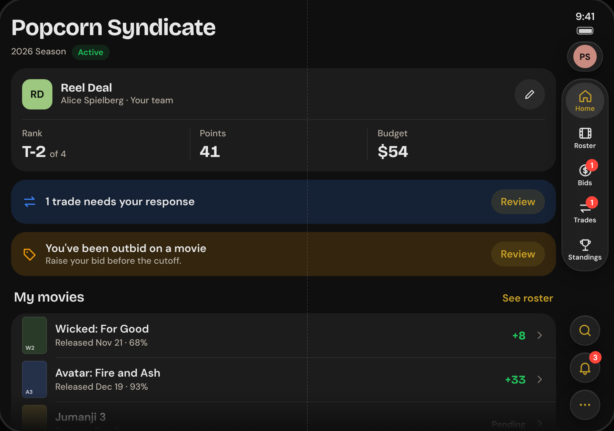
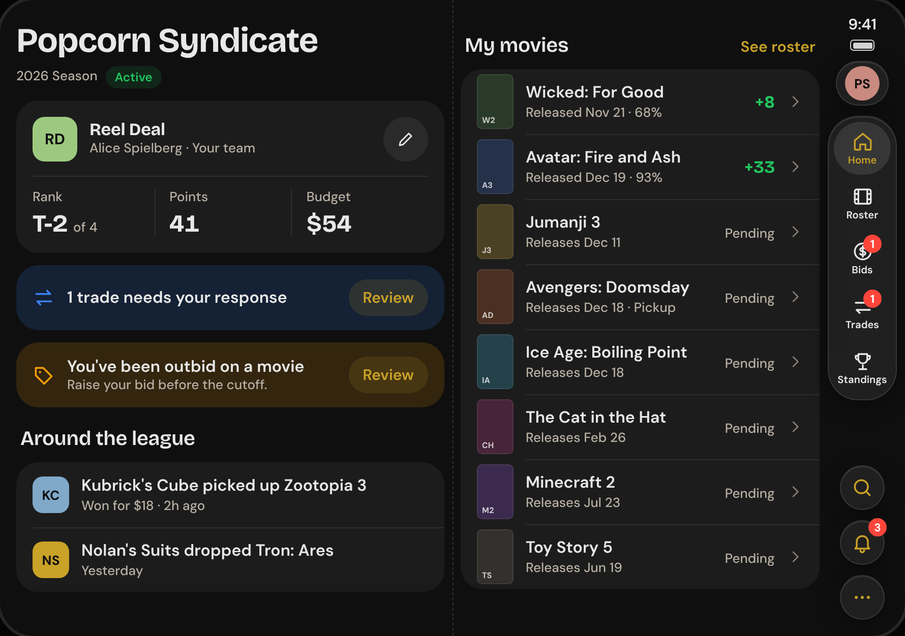
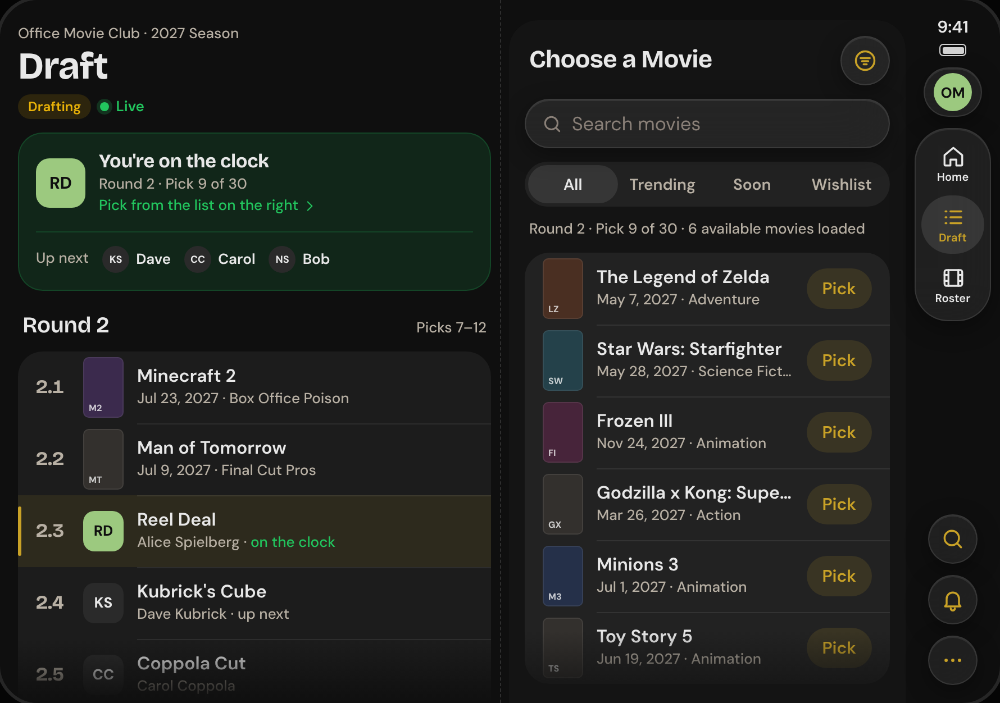
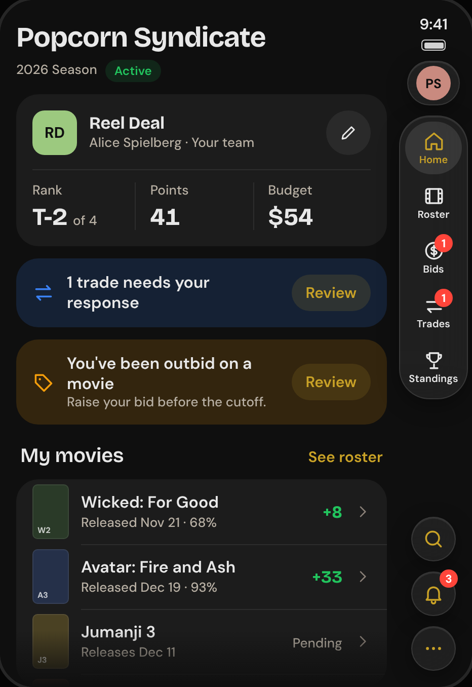
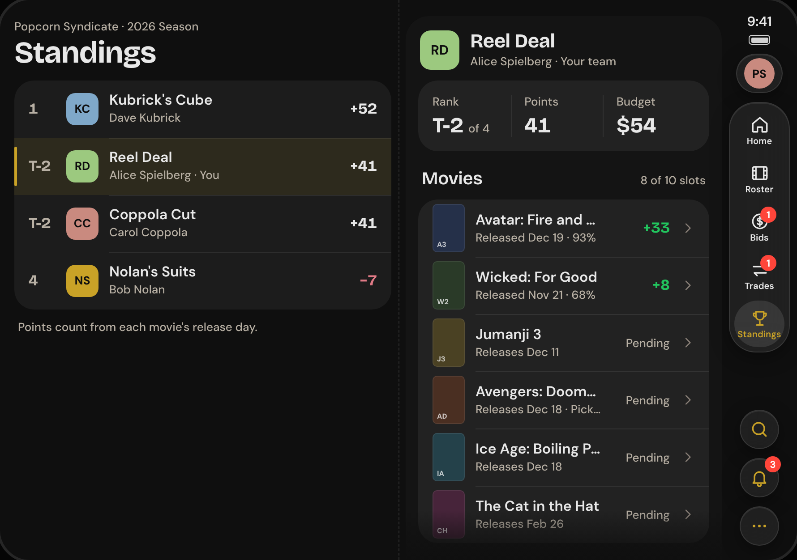
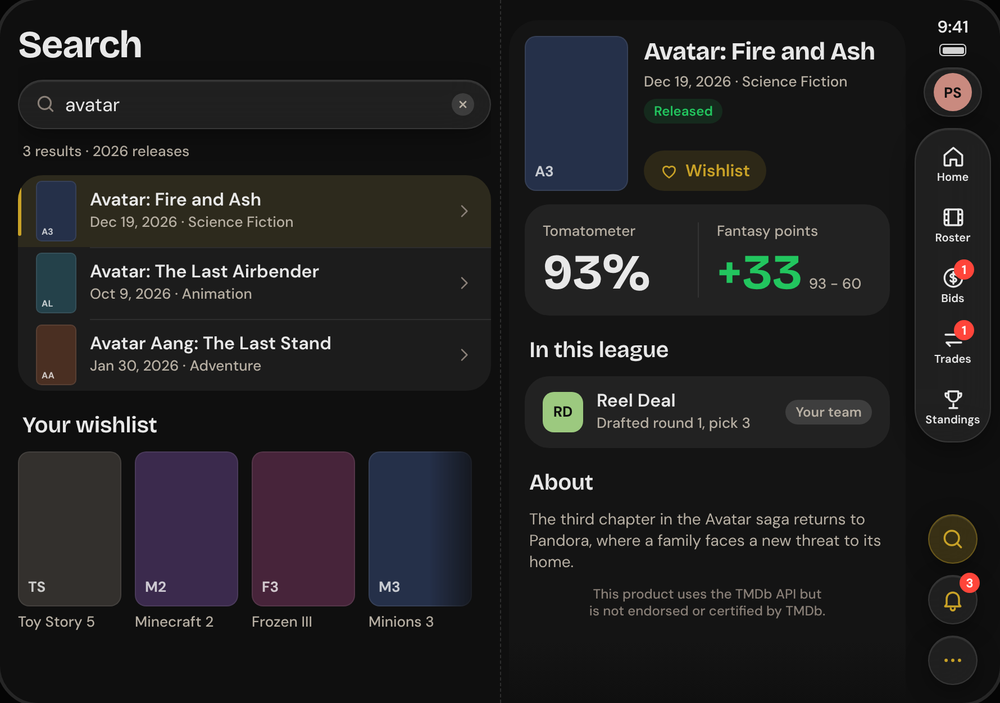
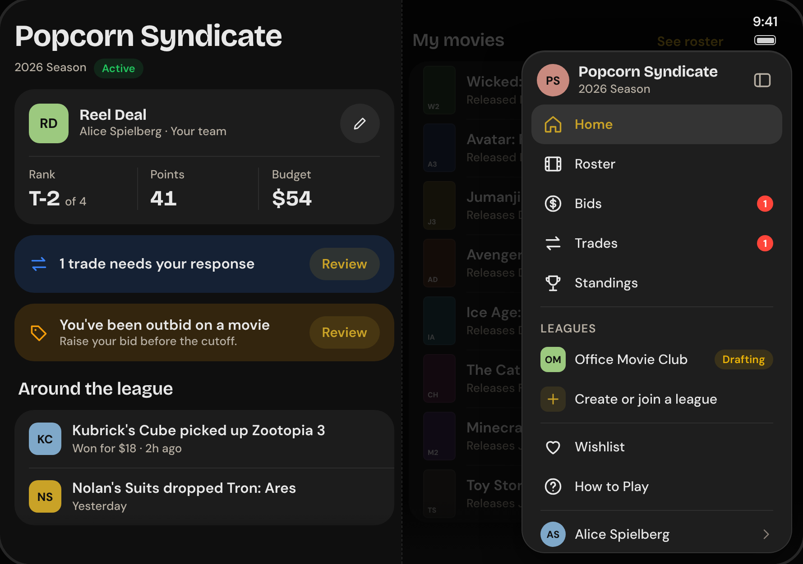
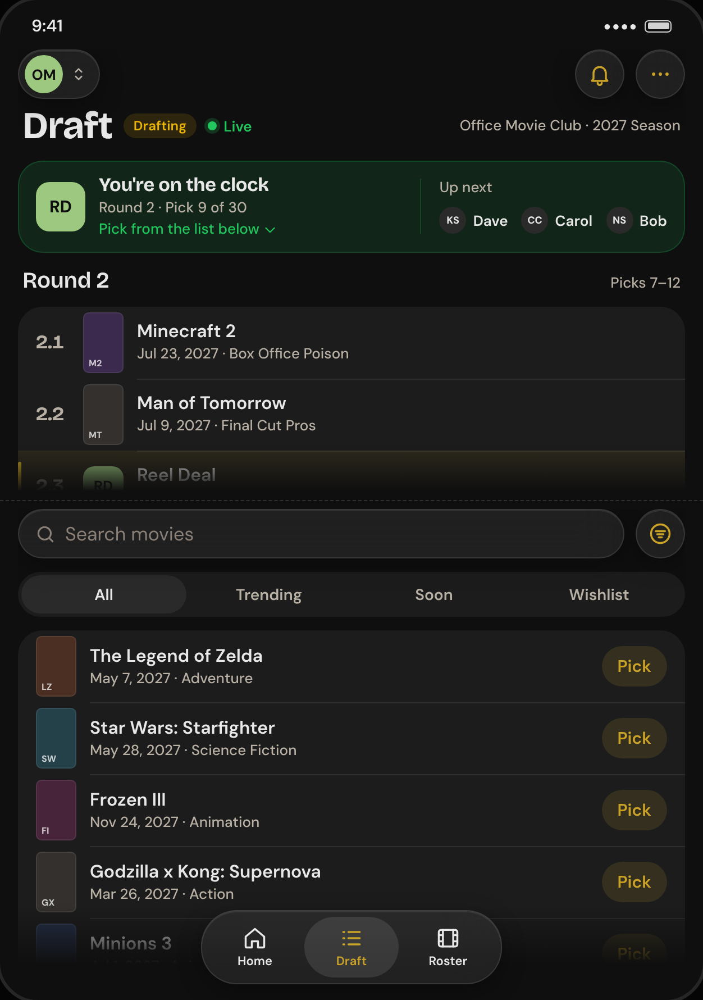

# iPhone Duo support plan

Status: plan with decisions recorded (section 8), 2026-11-11. Nothing here is built yet. This is the plan for making
the Fantasy Reel iOS app (`apps/ios/`) feel at home on iPhone Duo, Apple's folding
iPhone. It covers what the device is, what Apple asks of apps, what our app does
today, what we propose, and how to split the work across threads.

Facts about the device and its APIs come from the sources at the end. Each claim is
marked **[Apple]** (Apple's own pages or talks) or **[third party]** (blogs, Wikipedia).
Third-party claims and anything marked *unverified* must be confirmed in the simulator
during Phase 0 before a design depends on them.

## 1. The short version

- The Duo has two screens: a short, wide **outer** screen when closed and a large,
  nearly square-ish **inner** screen when open. The outer screen behaves like a small
  iPhone. The inner screen behaves like a small iPad.
- Our app is built with Xcode 26 today. An app built that way runs on the inner screen
  in a compatibility window with black bars **[third party]**. To fill the screen we
  must build with **Xcode 27.1** **[Apple]**. That is the first step and unlocks
  everything else.
- Our navigation uses Apple's standard building blocks (tab bar, navigation bars,
  sheets), so most of the "chrome" adapts on its own **[Apple]**. The real work is the
  **content**: every screen is one full-width column, which will look stretched on the
  inner screen.
- Proposed order: (0) build with the new Xcode, measure, and add one shared page
  container; (1) make every screen comfortable at both sizes; (2) add side-by-side
  layouts where they help most, starting with the draft room; (3) polish.

## 2. Words used in this doc

| Term | Plain meaning |
| --- | --- |
| Outer / inner display | The screen you see closed / open. |
| Point (pt) | iOS's layout unit. A 3x screen draws 3 pixels per point. |
| Size class | iOS's coarse label for available space: **compact** (phone-like) or **regular** (tablet-like), separately for width and height. Apps read it to pick a layout. |
| Safe area | The part of the screen not covered by cameras, rounded corners or system bars. Content goes inside it; backgrounds may extend past it. |
| Tab bar | The row of main sections at the bottom (Home, Roster, Bids…). `TabView` in code. |
| Sidebar | A column of navigation at the side of the screen, as on iPad. |
| Navigation stack | One screen pushed on top of another with a Back button. |
| Split view (in an app) | Two columns side by side: a list and the selected item's detail. `NavigationSplitView` in code. |
| Split View (system) | Two different apps side by side. New on iPhone with the Duo. |
| Sheet | A panel that slides up over the current screen for one task. |
| Detent | A resting height for a sheet (medium = half, large = full). |
| Pose / posture | How the Duo is held: closed, fully open, or partly folded and standing on a table. |
| SDK | The version of Apple's toolkit the app is built against. It comes with Xcode and is separate from the minimum iOS version the app supports. |

## 3. The device

| | Outer display (closed) | Inner display (open) |
| --- | --- | --- |
| Size | 5.4 in **[Apple]** | 7.6 in **[Apple]** |
| Pixels | 1398 × 2034 at 460 ppi **[Apple]** | 1878 × 2670 at 430 ppi **[Apple]** |
| Points (if 3x; our arithmetic, *unverified*) | about 466 × 678 | about 626 × 890 |
| Shape | about 1.45 : 1, far squatter than a normal iPhone (about 2.17 : 1) | about 1.42 : 1 |
| Size class, portrait | compact width, regular height **[Apple]** | regular width, regular height **[Apple]** |
| Size class, landscape | compact width, compact height **[Apple]** | regular width, regular height **[Apple]** |
| Honors a portrait-only setting | Yes (*our reading of conflicting wording*) | **No** **[Apple]** |

**The open screen is wider than it is tall.** Apple lists the device as 164.6 mm wide
by 117.8 mm tall when open, and 84.1 mm by 117.8 mm when closed **[Apple]**. So in the
normal open "book" pose the inner display is landscape-shaped (about 890 × 626 pt by
our arithmetic), with the fold running top to bottom down the middle. Each half is
about the size of the outer display. Turned a quarter turn (for example standing half
folded on a table) it is about 626 × 890 pt with the fold running left to right. Apple
quotes pixel sizes short side first, which hides this. The mockups in section 6 use
the book pose.

Other facts that matter to us:

- Ships with iOS 27.1, A20 Pro, released 2026-10-23 **[Apple]**. Book-style fold
  **[third party]**.
- **Opening or closing does not restart the app.** It is a size change, delivered as a
  size class update. Scroll position and typed text are generally kept **[Apple]**.
- On the outer display, system bars and app controls move to the **side** of the screen
  ("app navigation and controls now appear on the side") **[Apple]**. With the 27.1 SDK,
  standard toolbar buttons lay out vertically under the status bar **[Apple]**.
- That side is the **right** edge. Apple describes the app as using "the screen space
  to the left of the status bar and camera" **[Apple]**, so the clock, battery and the
  navigation under them form a strip down the right, and content sits to its left. Arik
  sees the same on his Duo when it is open (2026-11-11). Exact sizes are a Phase 0
  measurement.
- Tab bars adapt to every pose and can lay out vertically. On the inner display an app
  can opt into a sidebar with `.defaultTabBarPlacement(.sidebar)` **[Apple]**.
- On the inner display, sheets are centered rather than full width **[Apple]**.
- The user can put two apps side by side (system Split View), and open two windows of
  one app **[Apple]**. So even on the inner display our app may be given a narrow slice.
- Unlock is Touch ID in the side button **[Apple]**. We use no biometrics, so no impact.
- One point-size disagreement to resolve by measuring: a blog derives 669 × 951 pt for
  the inner display from App Store screenshot sizes **[third party]**, which does not
  match the panel's pixel count.

### What Apple asks of apps

1. Build with Xcode 27.1 to go edge to edge **[Apple]**.
2. Use standard containers (tab view, navigation stack, split view, toolbars, sheets).
   They adapt on their own. Custom bars do not, and there is no API to make them **[Apple]**.
3. Choose layouts from **size classes**, never from device name, orientation or fixed
   screen sizes. Do not use `UIScreen.main` **[Apple]**.
4. Keep content inside the safe area, which can be lopsided on the Duo (bars on one
   side). Let backgrounds bleed past it **[Apple]**.
5. Design two layouts, compact and regular, not one per pose **[third party, reporting
   an Apple design talk]**.
6. Scrolling content may run across the fold. Discrete controls should not sit on it.
   Prefer an even number of grid columns so the fold falls in a gap **[third party]**.
7. Test Split View **[Apple]**.

New APIs exist for the hinge angle (`onHingeChange`), the fold and camera areas
(`ReservedRegion`), and fold-aware two-part layouts (`ArrangementView`), all iOS 27.1+
**[Apple]**. We do not need them until Phase 3. Their exact shapes differ between
sources, so read Apple's documentation before using them.

## 4. Where our app stands today

Audited at `main` (`0c64f06`), 242 Swift files.

### Already in good shape

- **Standard navigation throughout.** `LeagueTabs` is a native `TabView`, each tab is a
  `NavigationStack`, the top bar is built from standard toolbar items, and the bottom
  action bar uses `safeAreaBar`. These are the pieces Apple adapts for us.
- **No device sniffing.** No `UIScreen`, no device-name checks, no orientation checks.
- **One sheet path.** Sheets go through `ShellSheet` / `ShellSheetView`, so sheet sizing
  on the inner display can be decided in one place.
- **Navigation state lives outside the views.** `ShellRouter` owns the selected tab and
  each tab's path, so a layout change on fold need not lose your place.
- **Dynamic Type work helps.** Rows already grow and reflow (`ViewThatFits`), which is
  the same muscle a short, wide outer display needs.

### Gaps

| # | Finding | Where | Effect on Duo |
| --- | --- | --- | --- |
| G1 | Built with Xcode 26; CI selects `Xcode_26*` | `.github/workflows/ios.yml`, `apps/ios/README.md` | Inner display shows a small window with black bars. Blocks everything. |
| G2 | The app never reads a size class | all of `FantasyReel/` | It cannot tell the inner display from the outer one. |
| G3 | No shared page container. Each screen builds its own `ScrollView` + column + 16 pt margin (52 scroll views, 67 margin paddings) | every `Features/*` screen | On a ~626 pt wide screen, cards and rows stretch edge to edge, with a wide empty gap between a movie title and its points. Fixing it screen by screen would mean 50 edits; a shared container makes it one rule. |
| G4 | Portrait only (`UISupportedInterfaceOrientations = Portrait`) | `project.pbxproj` | The inner display ignores this, so the app will be shown in landscape there for the first time. Untested. |
| G5 | Tab rules assume a bottom bar that holds five items | `LeagueNavigation.showsSearchTab` | With five league tabs, search moves to the top bar. A vertical bar or sidebar may have room for search, so the rule should depend on the layout. |
| G6 | League pill in the top bar is a text label | `LeagueTopBar.swift` | Top-bar items go vertical on the outer display. Text items reportedly stay horizontal **[third party]**; needs a look. The empty centered-title workaround also needs a check. |
| G7 | Bottom action bar buttons fill the width | `BottomActionBar.swift` | Very wide buttons on the inner display. On the outer display the tab bar is no longer beneath it, so "above the tab bar, in thumb reach" needs rechecking. |
| G8 | Sheets request specific heights (`.large`, `.medium`) | `MenuSheetView`, `DraftMoviePickerSheet`, `TeamProjectionViews`, `TradesView` | Centered sheets on the inner display may size differently. `TradeOfferCard` also attaches its own `.sheet`, which breaks our one-sheet rule and bypasses the central place. |
| G9 | The outer display is short (about iPhone SE height) but has a top bar, large header and sometimes a bottom action bar | tab roots | Less room for content. If bars do move to the side, this eases. Needs screenshots. |
| G10 | Welcome screen sizes itself to the viewport | `WelcomeView.swift` | Works, but stretches wide. Wants a width cap. |
| G11 | Screenshots and previews use one ordinary iPhone | `ios.yml`, `ScreenshotScenes.swift` | No way to review Duo layouts in a PR today. |
| G12 | Two windows of the app would each get their own stores | `SignedInRootView` | Unknown behavior. Not supported in the first release (Q4), so Phase 0 should make sure a second window cannot be opened. |

Not affected: push, deep links, auth, data and realtime code, the `FantasyReelKit`
package (apart from the tab rule in G5).

## 5. Design proposals

### P1. Outer display: a compact iPhone, checked for height

Keep today's design. Confirm with screenshots that the side-mounted bars look right,
that the league pill and bell work in a vertical bar, and that each tab root shows
enough content above the fold of the screen. Fix by trimming header space at compact
height, not by inventing a new layout.

### P2. Inner display, level 1: comfortable

One shared page container (working name `FRPage`) that every screen adopts:

- Narrow space: exactly today's layout.
- Wide space: content is capped at a comfortable reading width and centered, or flows
  into **two columns of cards** where a screen is a stack of independent cards (League
  Home, Roster, Bids, Standings with projections, Account, Settings).
- Bottom action bar buttons get a maximum width.

This alone makes every screen look intentional on the inner display and is low risk.

### P3. Inner display, level 2: side by side

Use the width to remove a navigation step where the app is busiest:

| Screen | Today | Proposed on the inner display |
| --- | --- | --- |
| **Draft room** | Board, then a full sheet to pick a movie | Board on the left, movie picker on the right, always visible. Highest value: it is the app's live, time-pressured moment. |
| Standings | List, push to a team | List on the left, selected team on the right |
| Movie search, Wishlist | List, push to a movie | Results on the left, movie detail on the right |
| Trades | Offers list, sheet to compose | Offers on the left, composer or offer detail on the right |
| Bids | List, push to priorities | Bids on the left, priorities on the right |

### P4. Inner display: a sidebar for global items

On the inner display the tabs sit in a slim rail on the right edge, under the clock
and battery (see mockups). Tapping the
league button at the top of the rail expands it into a sidebar that holds what the menu
sheet holds today: the tabs by name, other leagues, create or join, Wishlist, How to
Play and Account. Arik asked for a side menu in the original mockups; we used a sheet
because a drawer is not native on a phone. On the inner display a sidebar **is** the
native pattern. The outer display keeps the league button and menu sheet.

The mockup expands the rail in place, so the sidebar opens on the right. iPad sidebars
sit on the left, and we have not seen where iOS puts one on the Duo, so the prototype
starts by checking that. We follow whatever the system does.

Risk: the rail, the expanded sidebar and the outer display's bar are different
structures. Switching between them on open and close must not reset the screen you
are on. `ShellRouter` already holds that state, which is why this is feasible, but it
needs a prototype before we commit (decided in Q2).

### P5. Folded on a table: later

A partly folded "tabletop" draft view (board on the upper half, picker on the lower
half) is appealing but depends on the newest, least settled APIs. Park it in Phase 3.

## 6. Mockups

Design mockups for the open screen in its normal book pose, plus the closed screen.
They are drawn with the app's real fonts, colors and spacing, using sample data. The
HTML sources and a render script are in `docs/ios-duo/mockups/` (`node render.js`
rebuilds every PNG).

Read them with three cautions:

- **Sizes are estimates** (890 × 626 pt open, 466 × 678 pt closed), to be measured in
  Phase 0.
- **Where iOS puts the bars is approximated.** The clock, battery and navigation are
  drawn as a strip down the right edge, following Apple's description and what Arik
  sees on his own Duo. The exact width and look of that strip is not something we
  could check without the simulator, so the rail here is our best reading.
- The dashed line is the fold. Layouts keep a gutter there so no button sits on it.

### First release

**Without layout work.** What League Home looks like if we only rebuild with the new
Xcode: one column stretched across both halves, cards running through the fold, and a
long gap between each title and its value. This is the problem Phase 1 fixes.

**League Home, open (P2).** Left half: who you are and what needs you. Right half:
your movies. Same cards and rows as today, arranged in two columns. The rail takes
about 84 pt from the right half, so the right column is the narrower one.

**Draft room, open (P3, thread 2A).** The board on the left, the movie picker on the
right, both always visible. Today the picker is a full-screen sheet that hides the
board; here you can watch picks land while you choose. The "Choose a Movie" button
goes away because the list is already there.

**League Home, closed (P1).** The outer display keeps the single-column design. The
tabs sit in a rail on the right edge, under the clock and battery. The rail narrows
the content column, so long banner titles wrap to two lines.

### After the first release

**Standings with team detail (P3, thread 2C).** Tap a team on the left and its roster
shows on the right, with no push and no Back button.

**Movie search with detail (P3, thread 2C).** Results stay on the left while you read
about a movie on the right.

**Sidebar (P4, thread 2B).** The rail expanded: tabs by name, your other leagues,
Wishlist, How to Play and your account. It opens over the right half only, so the
left half stays readable.

**Draft room, half folded on a table (P5, Phase 3).** The upper half is for glancing:
who is on the clock and the latest picks. The lower half is for touching: search and
pick.

## 7. Work plan

Standing rules apply to every implementation PR: sign-off from the three reviewer
threads (iOS design, performance, code quality) and simulator screenshots in the PR
description. For Duo work, screenshots mean **outer and inner** display.

### Phase 0: foundations (one thread, lands first)

Runs on Arik's Mac through Remote Control, since it needs Xcode.

| Item | Work |
| --- | --- |
| 0.1 | Confirm Xcode 27.1 is installed on the Mac and on the CI runner image. Build with it. Keep the iOS 26 minimum. Update `ios.yml` and the README. |
| 0.2 | Run on the iPhone Duo simulator. **Measure and record in this doc:** point sizes, safe areas and size classes for closed, open portrait, open landscape, and system Split View. Resolve the third-party claims in section 3. |
| 0.3 | Capture every existing screenshot scene on both displays as a baseline, and attach them to the PR. This turns section 4 from prediction into evidence. |
| 0.4 | Extend the `ios-screenshots` CI label to capture Duo outer and inner shots. |
| 0.5 | Add the layout foundation: a width environment value derived from the size class, the `FRPage` container, and width caps on the bottom action bar and sheets. Adopt it on one screen as the reference example. Document the rules in `ARCHITECTURE.md`. |
| 0.6 | Decide landscape handling on the inner display from what 0.2 shows (G4). |

Exit: the app fills both displays, nothing is broken, and feature threads have a
container to adopt and a way to screenshot.

### Phase 1: comfortable everywhere (four threads in parallel)

Each thread adopts `FRPage` in its folders and fixes what the Phase 0 baseline shows.
Folders do not overlap, so the threads do not collide.

| Thread | Folders | Notes |
| --- | --- | --- |
| 1A Shell and navigation | `Navigation/`, `DesignSystem/Components/` (bars, glass controls), `FantasyReelCore/Navigation` | G5, G6, G7, G8, G9. Owns shared files; others ask before touching them. |
| 1B Team and market | `LeagueHome`, `Roster`, `Bids`, `Trades`, `Standings` | Two-column card layouts. Moves `TradeOfferCard`'s local sheet into `ShellSheet`. |
| 1C Movies and draft | `Movies`, `Wishlist`, `Draft` | Poster grids with even column counts. Draft stays single column here. |
| 1D Account and setup | `Auth`, `Account`, `Leagues`, `LeagueSettings`, `LeagueRules`, `Help`, `Inbox`, `Admin` | Mostly forms: reading-width cap. G10. |

Exit: every screen has reviewed outer and inner screenshots.

**The first Duo release is Phases 0 and 1 plus thread 2A (draft room).** Arik uses the
Duo mostly open, so design review starts with the inner display.

### Phase 2: side by side (parallel after Phase 1)

| Thread | Work | Depends on |
| --- | --- | --- |
| 2A Draft room | P3 draft layout: board and picker together | 1C |
| 2B Sidebar | P4, starting with a throwaway prototype of the open/close transition. After the first release. | 1A |
| 2C List and detail | P3 for Standings, Search, Wishlist, then Trades and Bids. After the first release; scope decided from using it. | 1B, 1C; easier after 2B settles the shell |

### Phase 3: polish

Tabletop draft pose (P5), system Split View and two-window QA, keyboard handling on the
inner display, App Store screenshots for the Duo, and a pass on the real device.

## 8. Decisions

Arik answered these on 2026-11-11.

| # | Question | Decision |
| --- | --- | --- |
| Q1 | How far should the first Duo release go? | Phases 0 and 1, plus the side-by-side draft room (2A). Ship, then decide on the rest. |
| Q2 | Sidebar on the inner display in place of the tab bar and menu sheet (P4)? | Yes, after a prototype proves the open/close transition keeps your place. Built after the first release. |
| Q3 | Allow landscape on the outer display? | No. Stay portrait there. The inner display rotates regardless. |
| Q4 | Allow two windows of Fantasy Reel side by side? | Not in the first release. Side by side with other apps still works. |
| Q5 | Keep the iOS 26 minimum? | Yes. Duo-only APIs sit behind version checks. |
| Q6 | Is Xcode 27.1 on Arik's Mac? | Reported installed by another thread. Phase 0 confirms it and checks for the iPhone Duo simulator. |
| Q7 | Turn on iPad afterwards (O-03)? | No iPad for now. Wide layouts are designed for the Duo's inner display only. |
| Q8 | Which is used more, open or closed? | Mostly open. Design review looks at the inner display first. |

Still open: whether the current App Store build shows in a small window with black
bars on the inner display (section 3, third-party claim). Phase 0 answers it.

## 9. Sources

Apple:

- [Apple unveils iPhone Duo](https://www.apple.com/newsroom/2026/09/apple-unveils-iphone-duo/) (press release, 2026-09-09)
- [iPhone Duo Tech Specs](https://support.apple.com/en-in/148588)
- [Prepare your app for iPhone Duo](https://developer.apple.com/videos/play/tech-talks/111461/) (Tech Talk)
- [A Summary of the iPhone Duo Group Lab](https://developer.apple.com/forums/thread/847644) (Apple developer forums, 2026-09-22; only the first third was read verbatim)

Third party:

- [iPhone Duo](https://en.wikipedia.org/wiki/IPhone_Duo) (Wikipedia)
- [What iOS Developers Need to Change in their Apps to Prepare for the iPhone Duo](https://www.infoq.com/news/2026/09/apple-iphone-duo-api/) (InfoQ)
- [iPhone Duo for iOS Developers: What Actually Changes in Your Swift Code](https://dev.to/arshtechpro/iphone-duo-for-ios-developers-what-actually-changes-in-your-swift-code-5gc5) (DEV)
- [Prepare Your SwiftUI App For iPhone Duo](https://www.theswift.dev/posts/prepare-your-swiftui-app-for-iphone-duo/)
- [Designing for iPhone Duo: What Moves, Splits, and Stays](https://blakecrosley.com/blog/designing-for-iphone-duo)

Not yet read, and worth reading in Phase 0: Apple's Human Interface Guidelines page
"Designing for iPhone Duo" and the companion Tech Talks on bars, adaptive layouts and
poses.
